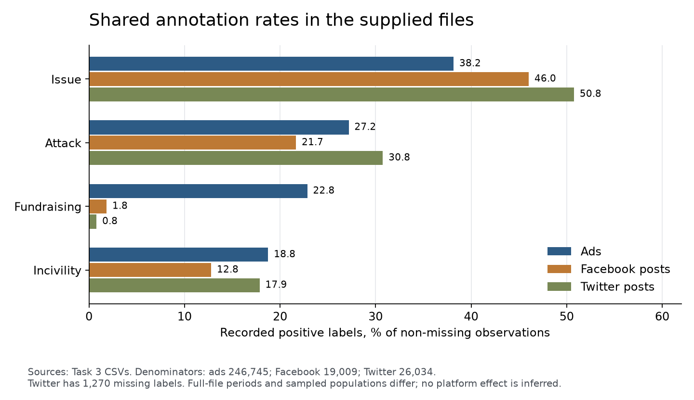

# Task 3 Descriptive Statistics

A reusable, schema-aware system applied without code changes to Facebook ads, Facebook posts, and Twitter posts. The checked results accompany the code, while source data and reconstructable row-level group outputs are excluded.

## Source and scope

Download the archive from the [source linked by Task 3](https://drive.google.com/file/d/1Jq0fPb-tq76Ee_RtM58fT0_M3o-JDBwe/view), extract its CSV files, and place them in `data/`. Do not commit that folder. See `verified_results/ads/summary.json` for the SHA-256 of the exact file used. The supplied ads archives describe the 2024 election, but some creation dates precede 2024.

The Task 2 ads file and the ads member of the Task 3 archive are byte-identical. They differ from the Task 1 file in schema, although all 246,745 ad identifiers overlap.

## Run

Python 3.12 was used. The pure Python script requires only the standard library. Install the other dependencies in a local environment:

```bash
python -m venv .venv
source .venv/bin/activate
python -m pip install -r requirements.txt
python pure_python_stats.py data/2024_fb_ads_president_scored_anon.csv --group page_id --group page_id,ad_id --output results/ads/pure_python
python pandas_stats.py data/2024_fb_ads_president_scored_anon.csv --group page_id --group page_id,ad_id --output results/ads/pandas
python polars_stats.py data/2024_fb_ads_president_scored_anon.csv --group page_id --group page_id,ad_id --output results/ads/polars
python compare_results.py results/ads/pure_python results/ads/pandas results/ads/polars
```

Run each engine on both remaining files. The group names come from inspected schemas; they are command-line parameters, not special cases in the statistics code.

```bash
for engine in pure_python pandas polars; do
  python "${engine}_stats.py" data/2024_fb_posts_president_scored_anon.csv --group Facebook_Id --group Type --output "results/facebook/$engine"
  python "${engine}_stats.py" data/2024_tw_posts_president_scored_anon.csv --group month_year --group source --output "results/twitter/$engine"
done
python compare_results.py results/facebook/pure_python results/facebook/pandas results/facebook/polars
python compare_results.py results/twitter/pure_python results/twitter/pandas results/twitter/polars
python cross_dataset.py --ads results/ads/pure_python/summary.json --facebook results/facebook/pure_python/summary.json --twitter results/twitter/pure_python/summary.json --output comparison
```

For the ad-specific narrative calculations, run:

```bash
python analyze_ads.py data/2024_fb_ads_president_scored_anon.csv --output ad_findings.json
python -m unittest test_stats
```

`FORMAT.md` documents missing values, type inference, standard deviation, deterministic modes, and the lossless singleton-group encoding. `expand_group.py` displays the full statistics for an individual group. Scripts accept any input filename; grouping keys and type overrides are explicit parameters.

## Findings and verification

Read `FINDINGS.md`, `REFLECTION.md`, and `CROSS_DATASET.md` for the platform comparison. The exact shared-column metrics are in `verified_results/comparison/`.

All required engine comparisons passed on the complete input files. Group-level exports were compared exhaustively where applicable. The result receipts retain counts and timings; large group exports are generated locally and ignored by Git. `verified_results` contains selected aggregate results, never the source CSVs.

Prepared on 2026-10-05. Reflections describe the implementation and observed runs. Source labels are taken as recorded; no classifier accuracy or causal effect is inferred.

## Figures

Regenerate with `python make_charts.py`.




## Cross-version estimate check

To reproduce `spend_validation.json`, also download the [Task 1 archive](https://drive.google.com/file/d/1gvtvX8fATFrrzraPmTSf205U8u3JExUR/view) and run:

```bash
python compare_spend_versions.py --task1 data/fb_ads_president_scored_anon.csv --task2 data/2024_fb_ads_president_scored_anon.csv
```
